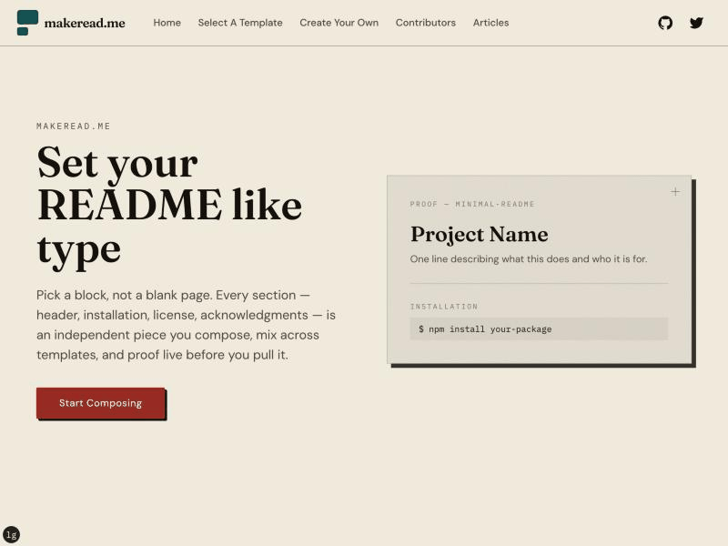

<br/>
<div align="center">
<a href="https://github.com/Abhisheksinha1506/readme-studio">

</a>
<h3 align="center">makeread.me</h3>
<p align="center">
Set your README like type — compose one from independent, swappable blocks instead of filling in a blank page.
<br/>
<br/>
<a href="#getting-started"><strong>Get started »</strong></a>
</p>
</div>


## Table of Contents

- [Table of Contents](#table-of-contents)
- [About The Project](#about-the-project)
  - [How it works](#how-it-works)
  - [Built With](#built-with)
- [Getting Started](#getting-started)
  - [Prerequisites](#prerequisites)
  - [Installation](#installation)
  - [Running with Docker](#running-with-docker)
- [Project Structure](#project-structure)
- [API](#api)
- [Running Tests](#running-tests)
- [Roadmap](#roadmap)
- [Contributing](#contributing)
- [License](#license)
- [Contact](#contact)
- [Acknowledgments](#acknowledgments)

## About The Project



Writing a README from scratch is tedious, and most generators only let you fill in one fixed template. makeread.me instead composes a README from **independent blocks** — Header, Installation, License, Acknowledgments, and so on — each backed by its own Nunjucks macro. Pick a template to start from, add or remove blocks, mix blocks across different templates ("Create Your Own"), fill in the fields, and watch the **proof** (a live, debounced preview) update as you type. When it's right, copy it to your clipboard or download it as `README.md`.

It's free and open-source, built around a catalog of real community README templates (othneildrew's Best-README-Template, purplebooth's, pottekkat's awesome-readme, fernanda-kipper's, plus a few original ones: a minimal template, a developer-portfolio template, and an API/library-docs template), each crediting its original author.

### How it works

1. **Pick blocks.** Each block (a "function" in the data model) carries its own variables — text inputs, text areas, checkboxes, lists, nested objects, select/radio options — and its own Nunjucks macro.
2. **Fill in values.** The editor renders the right form widget per variable type.
3. **Proof it live.** Every edit is debounced client-side, then sent to the backend, which resolves the selected blocks and macros against the database and renders the result server-side — the backend is the single source of truth for what gets rendered, so the preview always matches the real output.
4. **Pull it.** Copy to clipboard or download `README.md`.

### Built With

- [Next.js 13](https://nextjs.org/) (App Router) + [React 18](https://react.dev/) + [Tailwind CSS](https://tailwindcss.com/) — frontend
- [Express](https://expressjs.com/) + [MongoDB](https://www.mongodb.com/) (via [Mongoose](https://mongoosejs.com/)) + [Zod](https://zod.dev/) — backend
- [Nunjucks](https://mozilla.github.io/nunjucks/) — the macro/templating engine behind every block
- [openapi-typescript-codegen](https://github.com/ferdikoomen/openapi-typescript-codegen) — the frontend's typed API client, generated from the backend's own Zod → OpenAPI spec
- [TanStack Query](https://tanstack.com/query) — data fetching and caching on the frontend
- [Contentlayer2](https://contentlayer.dev/) — the MDX-powered `/articles` blog

## Getting Started

### Prerequisites

- [Node.js](https://nodejs.org/) 22+ (the backend's Dockerfile and CI both pin Node 22; `sharp`, a frontend dependency, requires Node ≥20.9)
- [Yarn](https://yarnpkg.com/) (both `backend/` and `frontend/` use `yarn.lock`)
- A MongoDB connection is **not required for local development** — the backend seeds an in-memory MongoDB (via `mongodb-memory-server`) automatically outside of `NODE_ENV=production`.

### Installation

1. **Clone the repository:**

   ```sh
   git clone https://github.com/Abhisheksinha1506/readme-studio.git
   ```

2. **Install backend packages:**

   ```sh
   cd backend && yarn install
   ```

3. **Set up the backend environment:** create a `.env` file in `backend/` with:

   ```
   NODE_ENV=development
   PORT=8080
   ```

   (`MONGO_PRIVATE_URL` is only required when `NODE_ENV=production`; development always uses the in-memory database.)

4. **Run the backend:**

   ```sh
   yarn dev
   ```

   This seeds every template under `backend/public/` into the database and starts the API at `http://localhost:8080`.

5. **Install frontend packages**, in a separate terminal:

   ```sh
   cd frontend && yarn install
   ```

6. **Set up the frontend environment:** create a `.env` file in `frontend/` with:

   ```
   NEXT_PUBLIC_BACKEND_URL=http://localhost:8080
   ```

   This is read by `frontend/lib/apiWrapper.ts` and by the generated OpenAPI client's `BASE` URL. The generated client itself lives in `frontend/openAPI/generated` and already targets the backend's `/v1` paths — no code changes are needed when the backend URL changes, only this env var.

7. **Run the frontend:**

   ```sh
   yarn dev
   ```

   The app is now running at `http://localhost:3000`.

### Running with Docker

Both `backend/` and `frontend/` have their own `Dockerfile`.

```sh
docker build -t readme-studio-backend ./backend
```

```sh
docker build --build-arg NEXT_PUBLIC_BACKEND_URL=<url-the-browser-can-reach> -t readme-studio-frontend ./frontend
```

`NEXT_PUBLIC_BACKEND_URL` is a build-time `ARG`/`ENV` for the frontend image — it's baked into the client bundle at `docker build` time, not read at container start. Point it at a URL the **browser** can actually resolve (not a Docker-internal hostname like `host.docker.internal`); changing it later means rebuilding the image, not just restarting the container.

## Project Structure

```
backend/
  src/
    api/templates/      Template & compile endpoints (defaultBlocks, macros, preview, compile)
    api/sideBar/         Browse/search/filter endpoints
    common/utils/        compileTemplate.ts (the shared Nunjucks render pipeline), env, caching
    db.ts                 Seeds backend/public/*/blocks.json + macros.json into MongoDB at boot
  public/<folder>/        One directory per template: blocks.ts (source), macros/*.njk, preview.md
  script/generate.ts      Hashes human-readable names into deterministic ids, writes blocks.json/macros.json
  test/                   Backend test suite (tsx --test)

frontend/
  app/                    Next.js App Router pages (/, /select-template, /generator/[id], /contributors, /articles)
  components/              GenerateTemplate (the editor), SelectTemplate, Home, ui (shared primitives)
  openAPI/generated/       Typed API client, generated from the backend's live OpenAPI spec
  content/articles/        MDX blog posts (Contentlayer2)
```

## API

The backend exposes a documented REST API under `/v1` (Swagger UI at the backend's root `/`, spec at `/swagger.json`). Key endpoints:

| Method | Path | Purpose |
|---|---|---|
| `GET` | `/v1/sidebar/all`, `/v1/sidebar/all/options` | Browse/filter all templates |
| `GET` | `/v1/sidebar/template`, `/v1/sidebar/template/options` | Template-scoped search/filter |
| `GET` | `/v1/template/template/:id/defaultBlocks` | A template's startup blocks |
| `GET` | `/v1/template/template/:id/preview` | The committed static preview for a template |
| `POST` | `/v1/template/compile` | Renders a README from `{blocks: [{folder, function}], variables}` — the backend resolves every block against the database; it never trusts macro/function text from the client |

Whenever the backend's API surface changes, regenerate the frontend's typed client with `yarn generate` in `frontend/` (the backend must be running — the script reads its live `/swagger.json`).

## Running Tests

```sh
cd backend && yarn test
```

Runs the full suite via Node's built-in test runner (`tsx --test`), including: endpoint tests, the duplicate-name collision guard, render-pipeline snapshot tests for every template, a check that `yarn generate` is idempotent, and a check that no internal identifier leaks into rendered prose.

## Roadmap

- [x] Add backend swagger generation
- [x] Add backend
- [x] Allow dynamic input field generation based off a JSON file
- [x] Allow users to set the order of components or delete them
- [x] Allow templating via Nunjucks
- [x] Add more templates (minimal, developer-portfolio, API/library-docs)
- [x] Move rendering logic to the backend, with debounce
- [x] Add caching (backend `Cache-Control` + frontend `staleTime`, for data that's static for the backend's lifetime)
- [x] Replace useEffect with react query
- [x] Avoid key collisions when using non-unique names as ids in templates
- [ ] Write up README best-practice articles

See [open issues](https://github.com/Abhisheksinha1506/readme-studio/issues) for anything not listed here.

## Contributing

Contributions are welcome. Fork the repo, create a feature branch, and open a pull request — see [`backend/README.md`](backend/README.md) and [`frontend/README.md`](frontend/README.md) for the development workflow of each half of the project.

## License

This repository does not currently include a license file. Until one is added, the default copyright rules apply (all rights reserved) — contact the maintainer before reusing this code.

## Contact

Project: [https://github.com/Abhisheksinha1506/readme-studio](https://github.com/Abhisheksinha1506/readme-studio)

## Acknowledgments

- [ShaanCoding](https://github.com/ShaanCoding) — original creator of makeread.me
- [othneildrew](https://github.com/othneildrew), [PurpleBooth](https://github.com/PurpleBooth), [Navendu Pottekkat](https://github.com/pottekkat), [Fernanda Kipper](https://github.com/Fernanda-Kipper) — original authors of the bundled community templates
